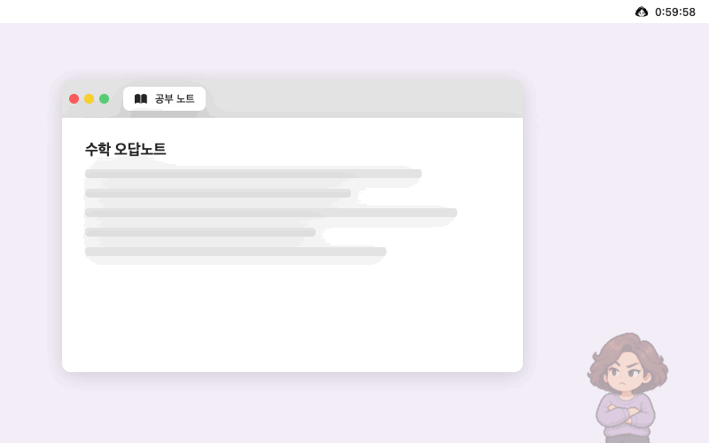

  

<h1 align="center">엄마 안 잔다</h1>

공부하는 동안 화면 구석에서 엄마가 몰래 지켜보다가 유튜브·인스타 같은 딴짓 탭을 열면 달려와서 닫아 버리고, 공부가 끝나면 간식을 들고 오는 macOS 앱이에요.

  

<a href="../../releases">Releases</a>에서 dmg를 받아 앱을 Applications로 옮겨 연 뒤, 성별과 공부 시간을 고르고 <b>공부 시작</b>을 누르면 돼요.

